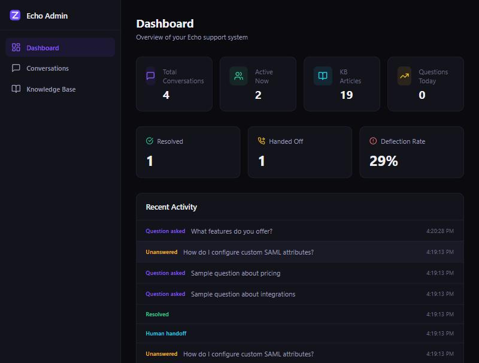

# Echo — AI Customer Support Chatbot

> Intelligent customer support platform with knowledge base and admin console, built by [Zolentix](https://zolentix.com)



## Features

- **AI Chat Widget** — Embeddable chatbot that answers questions from your knowledge base
- **Knowledge Base** — Upload docs, FAQs, and guides; Echo learns your business
- **Admin Console** — Dashboard with conversation analytics, deflection rate, and activity feed
- **Human Handoff** — Seamlessly escalate to human agents when the bot can't help
- **Conversation History** — Full transcript management with status tracking
- **Smart Search** — AI-powered responses grounded in your knowledge base articles

## Tech Stack

- **Framework:** Next.js 14 (App Router)
- **Language:** TypeScript
- **Styling:** Tailwind CSS
- **Database:** Prisma ORM + SQLite
- **Fonts:** Space Grotesk + Inter

## Getting Started

```bash
npm install
npx prisma db push
npx prisma db seed
npm run dev
```

Open [http://localhost:3000](http://localhost:3000) for the landing page.
Admin console at [http://localhost:3000/admin](http://localhost:3000/admin) (demo: admin@echo.zolentix.com / echo2024).

## License

MIT — [Zolentix](https://zolentix.com)
